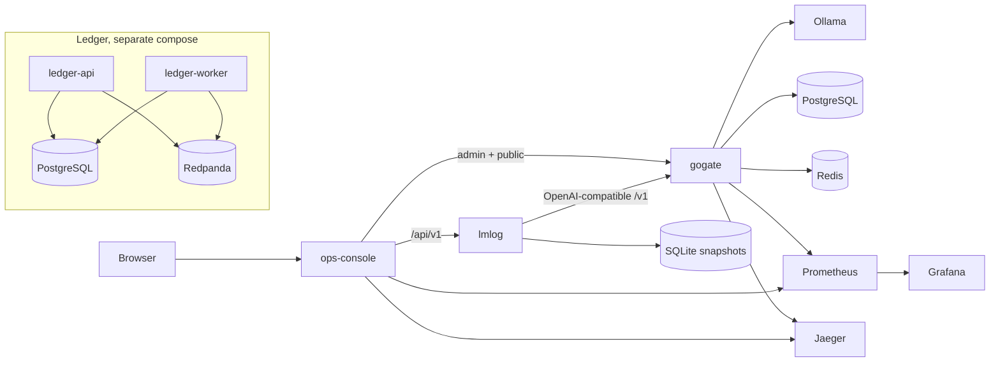

# AI Ops Stack

One local stack for AI traffic, logs and an operations console.

[](https://github.com/yugrinovD/ai-ops-stack/actions/workflows/ci.yml)
[](LICENSE)


`ai-ops-stack` is the entry point for the portfolio: a Compose stack, key
bootstrap, smoke tests, screenshots and documentation. Business logic lives in
the four projects below.

## Projects

| Project | What it demonstrates |
| --- | --- |
| **[gogate](https://github.com/yugrinovD/gogate)** | Go LLM gateway: OpenAI-compatible API, retry/fallback before the first byte, RPM/TPM, cache, cost budgets, audit, Prometheus/OTel. 500 RPS, p99 < 1 ms on mock. |
| **[lmlog](https://github.com/yugrinovD/lmlog)** | Python log intelligence: signatures, ERROR clusters, trends, deduplication, heuristic/LLM explanations. ~90,000 lines/s, designed for 50M+ lines/day. |
| **[ops-console](https://github.com/yugrinovD/ops-console)** | Next.js BFF/UI: dashboard, playground, SSE, RBAC, log analysis, traces, alerts, Playwright. |
| **[ledger](https://github.com/yugrinovD/ledger)** | Go double-entry ledger: idempotency, outbox, reconciliation, Kafka/Redpanda, 2000 req/s in benchmarks. |

`ledger` is a separate Go project. `make up` here starts the AI path
(`gogate` + `lmlog` + `ops-console`); ledger runs from its own repository.

## Architecture



See [docs/OPERATIONS.en.md](docs/OPERATIONS.en.md) and
[ADR 0001: LLM ownership](docs/adr/0001-llm-ownership.en.md).

## Quick start

Requirements: Docker Compose v2, `make`, `curl`, `jq`, `openssl`. Go, Python and
Node are only needed to run individual projects outside Docker.

Compose builds images from sibling directories, so keep the repositories next to
each other:

```text
workspace/
  ai-ops-stack/
  gogate/
  lmlog/
  ops-console/
  ledger/
```

```bash
git clone git@github.com:yugrinovD/ai-ops-stack.git
cd ai-ops-stack

./scripts/clone-all.sh   # clones gogate, lmlog, ops-console, ledger next to this repo
make init-env            # .env + .secrets/runtime.env
make up                  # postgres/redis/ollama -> pull -> gogate -> keys -> lmlog/ops
make smoke               # health + upload + explain (expects source=llm)
```

The first run downloads `qwen2.5:3b` (~2 GB) and may take several minutes.

After startup:

- UI: <http://localhost:3100> (`CONSOLE_AUTH_TOKEN` from `.env`)
- gogate API: <http://localhost:8080/v1>
- gogate admin: <http://localhost:9090/admin/v1>
- lmlog: <http://localhost:8090/healthz>
- Prometheus: <http://localhost:9092>
- Grafana: <http://localhost:3000>
- Jaeger: <http://localhost:16686>

Degradation check:

```bash
make smoke-fallback   # stops gogate and expects source=heuristic
```

Ledger:

```bash
cd ../ledger
make up
```

## Demo

| Screenshot | What it shows |
| --- | --- |
|  | RPS, latency, errors, tokens, cost, cache hit |
|  | streaming playground with provider/usage |
|  | signatures, ERROR clusters and explain |
|  | audit and span waterfall |

Recording plan for the 3–5 minute demo: [docs/DEMO.md](docs/DEMO.md).

## Ownership

| Component | Owns | Does not do |
| --- | --- | --- |
| `ai-ops-stack` | Compose, key bootstrap, smoke, demo, docs | no business logic |
| `gogate` | providers, retry/fallback, limits, cache, cost, audit | no log analysis |
| `lmlog` | ingest, signatures, errors, trends, explanations | no direct Ollama access in the full stack |
| `ops-console` | UI/BFF, aggregation of gogate + lmlog | no Ollama knowledge |
| `ledger` | double-entry, outbox, reconciliation | not part of the AI path |
| `ollama` | models and inference | not published to the host |
| `postgres` / `redis` | control plane and hot path | not the source of truth for logs |

## Documentation

- [Operations](docs/OPERATIONS.en.md) · [Russian](docs/OPERATIONS.md)
- [AI workflow](AI_WORKFLOW.md)
- [ADR 0001: LLM ownership](docs/adr/0001-llm-ownership.en.md) · [RU](docs/adr/0001-llm-ownership.md)
- [gogate: design, benchmarks, threat model, ADR](https://github.com/yugrinovD/gogate)
- [lmlog: design](https://github.com/yugrinovD/lmlog)
- [ops-console: contracts, security, operations](https://github.com/yugrinovD/ops-console)
- [ledger: ADR, benchmarks, security](https://github.com/yugrinovD/ledger)

## Status

Current slice: `v0.1.0` (first public set).

Done: gateway, log intelligence, console, ledger, Compose, smoke/fallback,
metrics, traces, tests.

Next: resource limits, release artifacts, CI parity and demo video.

## License

MIT. See [LICENSE](LICENSE).
