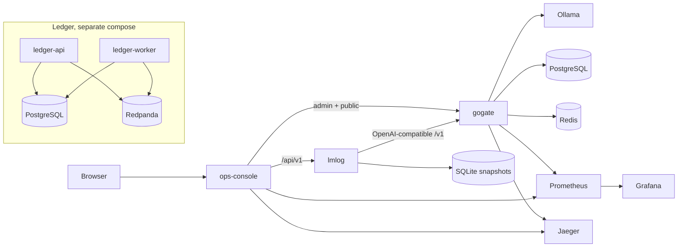
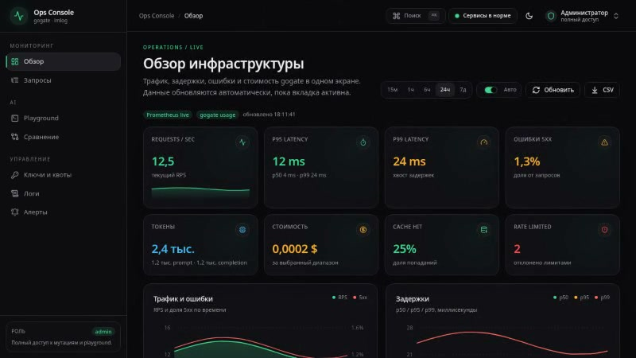
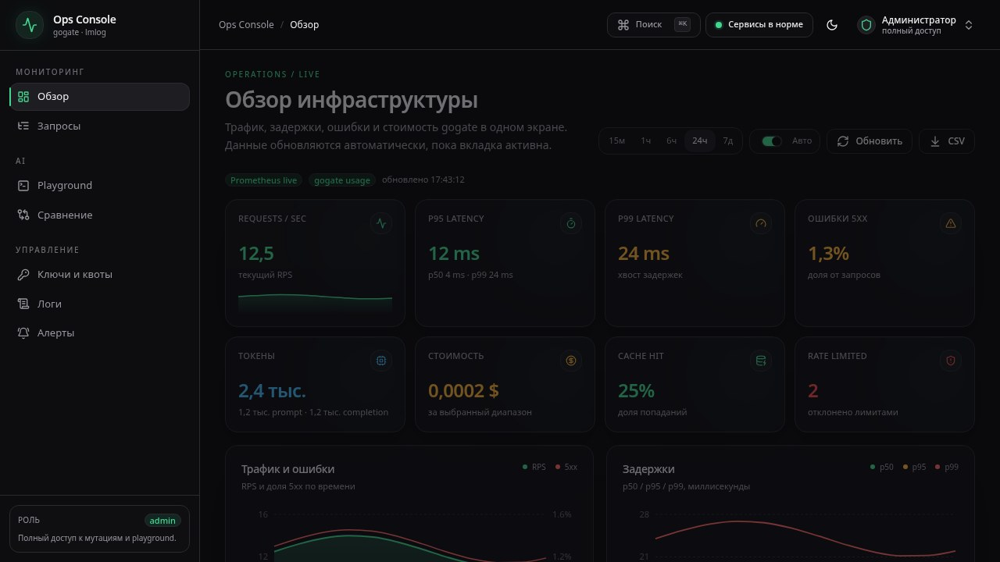
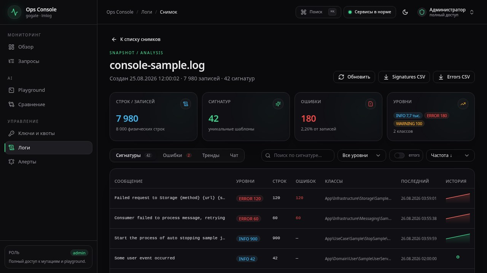

# AI Ops Stack

[](https://github.com/yugrinovD/ai-ops-stack/actions/workflows/ci.yml)
[](LICENSE)
[](https://github.com/yugrinovD/ai-ops-stack/releases)

A small local stack around an LLM gateway: `gogate`, `lmlog`, `ops-console` and a
separate `ledger`. It starts with one `make up` and needs no external keys — mock
and Ollama are the defaults.

It started with logs: I got tired of reading millions of lines by hand and still
missing the errors. That became `lmlog`, then `gogate` — mostly to keep upstream
keys out of tests — and later the console.

`ledger` is a separate story. It is not part of the AI loop; it was just
convenient to keep it nearby.

## What's inside

**gogate** — an LLM gateway. It speaks the OpenAI API and can sit in front of
mock, Ollama or any OpenAI-compatible upstream. On mock it does 500 RPS with p99
under a millisecond. That number is about the proxy, not the model.

**lmlog** — log analysis. It turns a noisy stream into signatures, errors and
trends, then explains findings with a local LLM or a deterministic heuristic. On
the test box it handled 12M lines a day.

**ops-console** — the web UI. Dashboard, playground, keys and quotas, log
analysis and traces. The browser only talks to the BFF; tokens stay on the
server.

**ledger** — a double-entry ledger in Go. Idempotency, outbox, reconciliation,
Kafka/Redpanda. Benchmarked at 2000 requests per second.

## How it fits together



`gogate` is the only service that talks to Ollama. `lmlog` calls `gogate`;
`ops-console` talks to both. `ledger` has its own compose file and no connection
to the AI path.

## Quick start

You need Docker Compose v2, `make`, `curl`, `jq` and `openssl`. Go, Python and
Node are only needed if you run the projects outside Docker.

Compose builds images from sibling directories, so keep the repositories next to
each other:

```text
workspace/
  ai-ops-stack/
  gogate/
  lmlog/
  ops-console/
  ledger/
```

```bash
git clone git@github.com:yugrinovD/ai-ops-stack.git
cd ai-ops-stack

./scripts/clone-all.sh   # clones the other four repositories
make init-env            # .env + .secrets/runtime.env
make up                  # postgres/redis/ollama -> pull -> gogate -> keys -> lmlog/ops
make smoke               # health + upload + explain (expects source=llm)
```

The first run downloads `qwen2.5:3b` (~2 GB) and takes a few minutes. Don't run
two Ollama containers at once: double RAM and a port conflict on `11434`.

After startup:

- UI: <http://localhost:3100> (`CONSOLE_AUTH_TOKEN` from `.env`)
- gogate API: <http://localhost:8080/v1>
- lmlog: <http://localhost:8090/healthz>
- Prometheus: <http://localhost:9092>, Grafana: <http://localhost:3000>, Jaeger: <http://localhost:16686>

Check the fallback path:

```bash
make smoke-fallback   # stops gogate and expects source=heuristic
```

`ledger` starts from its own directory:

```bash
cd ../ledger
make up
```

## Demo

[](docs/demo.mp4)

A short UI highlight: dashboard, playground, compare, logs, traces and keys.
The full 3–5 minute script is in [docs/DEMO.md](docs/DEMO.md).

| | |
| --- | --- |
|  |  |

## Known rough edges

- Ollama runs on CPU with a 3B model. Fine for a demo, not for production.
- The full voice-over video is not recorded yet; there is a 28-second highlight.
- `ops-console` has one token and two roles. It is not an IdP.
- `lmlog` keeps state in SQLite and assumes a single process.
- `ledger` is not a production PSP: no PCI DSS, KYC/AML or FX.

## Links

- [Operations](docs/OPERATIONS.en.md) · [Russian](docs/OPERATIONS.md)
- [AI workflow](AI_WORKFLOW.md)
- [Changelog](CHANGELOG.md)
- [ADR 0001: LLM ownership](docs/adr/0001-llm-ownership.en.md)
- [gogate](https://github.com/yugrinovD/gogate) · [lmlog](https://github.com/yugrinovD/lmlog) · [ops-console](https://github.com/yugrinovD/ops-console) · [ledger](https://github.com/yugrinovD/ledger)

## License

MIT. See [LICENSE](LICENSE).
