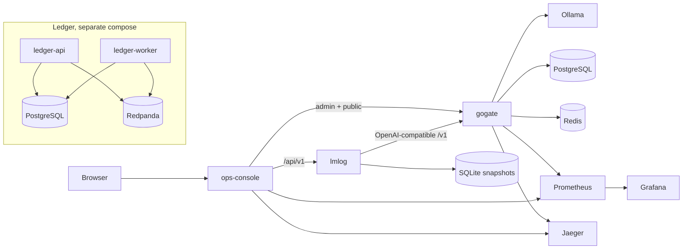

# AI Ops Stack

Один локальный стек для AI-трафика, логов и операционной консоли.

[](https://github.com/yugrinovD/ai-ops-stack/actions/workflows/ci.yml)
[](LICENSE)


`ai-ops-stack` — входная точка в портфель: compose-стек, bootstrap ключей,
smoke-тесты, скриншоты и документация. Бизнес-логики здесь нет — она в четырёх
проектах ниже.

## Что внутри

| Проект | Что демонстрирует |
| --- | --- |
| **[gogate](https://github.com/yugrinovD/gogate)** | Go LLM gateway: OpenAI-compatible API, retry/fallback до первого байта, RPM/TPM, кэш, cost budgets, audit, Prometheus/OTel. 500 RPS, p99 < 1 ms на mock. |
| **[lmlog](https://github.com/yugrinovD/lmlog)** | Python log intelligence: сигнатуры, ERROR-кластеры, тренды, дедупликация, heuristic/LLM explanations. ~90 000 строк/с, расчёт на 50M+ строк в сутки. |
| **[ops-console](https://github.com/yugrinovD/ops-console)** | Next.js BFF/UI: dashboard, playground, SSE, RBAC, разбор логов, трейсы, alerts, Playwright. |
| **[ledger](https://github.com/yugrinovD/ledger)** | Go double-entry ledger: idempotency, outbox, reconciliation, Kafka/Redpanda, 2000 req/s в benchmark. |

`ledger` — отдельный Go-проект. `make up` в этом репозитории поднимает
AI-контур (`gogate` + `lmlog` + `ops-console`), ledger запускается из своего
репозитория.

## Архитектура



Подробнее: [docs/OPERATIONS.md](docs/OPERATIONS.md), [ADR 0001: LLM ownership](docs/adr/0001-llm-ownership.md).

## Быстрый старт

Нужны Docker Compose v2, `make`, `curl`, `jq`, `openssl` и Go/Python/Node
только если вы хотите запускать проекты вне Docker.

Compose собирает образы из соседних каталогов, поэтому репозитории должны
лежать рядом:

```text
workspace/
  ai-ops-stack/
  gogate/
  lmlog/
  ops-console/
  ledger/
```

```bash
git clone git@github.com:yugrinovD/ai-ops-stack.git
cd ai-ops-stack

./scripts/clone-all.sh   # клонирует gogate, lmlog, ops-console, ledger рядом
make init-env            # .env + .secrets/runtime.env
make up                  # postgres/redis/ollama → pull → gogate → ключи → lmlog/ops
make smoke               # health + upload + explain (ожидает source=llm)
```

Первый запуск скачивает `qwen2.5:3b` (~2 ГБ) и занимает несколько минут.

После запуска:

- UI: <http://localhost:3100> (`CONSOLE_AUTH_TOKEN` из `.env`)
- gogate API: <http://localhost:8080/v1>
- gogate admin: <http://localhost:9090/admin/v1>
- lmlog: <http://localhost:8090/healthz>
- Prometheus: <http://localhost:9092>
- Grafana: <http://localhost:3000>
- Jaeger: <http://localhost:16686>

Проверка деградации:

```bash
make smoke-fallback   # останавливает gogate и ожидает source=heuristic
```

Ledger:

```bash
cd ../ledger
make up
```

## Демо

| Скриншот | Что видно |
| --- | --- |
|  | RPS, latency, errors, tokens, cost, cache hit |
|  | streaming playground с provider/usage |
|  | сигнатуры, ERROR-кластеры и explain |
|  | audit и span waterfall |

Сценарий записи demo-видео (3–5 минут): [docs/DEMO.md](docs/DEMO.md).

## Владение компонентами

| Компонент | Отвечает за | Не делает |
| --- | --- | --- |
| `ai-ops-stack` | compose, bootstrap ключей, smoke, demo, документация | не содержит бизнес-логики |
| `gogate` | провайдеры, retry/fallback, rate limit, кэш, стоимость, audit | не анализирует логи |
| `lmlog` | ingest, сигнатуры, ошибки, тренды, объяснения | не ходит в Ollama в полном стеке |
| `ops-console` | UI/BFF, агрегация gogate + lmlog | не знает про Ollama |
| `ledger` | double-entry, outbox, reconciliation | не является частью AI-пути |
| `ollama` | модели и inference | не публикуется наружу |
| `postgres` / `redis` | control plane и hot path | не являются source of truth для логов |

## Документация

- [Operations](docs/OPERATIONS.md) · [English](docs/OPERATIONS.en.md)
- [AI workflow](AI_WORKFLOW.md)
- [ADR 0001: LLM ownership](docs/adr/0001-llm-ownership.md) · [EN](docs/adr/0001-llm-ownership.en.md)
- [gogate: design, benchmarks, threat model, ADR](https://github.com/yugrinovD/gogate)
- [lmlog: design](https://github.com/yugrinovD/lmlog)
- [ops-console: contracts, security, operations](https://github.com/yugrinovD/ops-console)
- [ledger: ADR, benchmarks, security](https://github.com/yugrinovD/ledger)

## Статус

Текущий срез — `v0.1.0` (первый публичный набор).

Готово: gateway, log intelligence, console, ledger, compose, smoke/fallback,
метрики, трейсы, тесты.

Дальше: resource limits, release artifacts, CI parity и demo video.

## Лицензия

MIT. См. [LICENSE](LICENSE).
