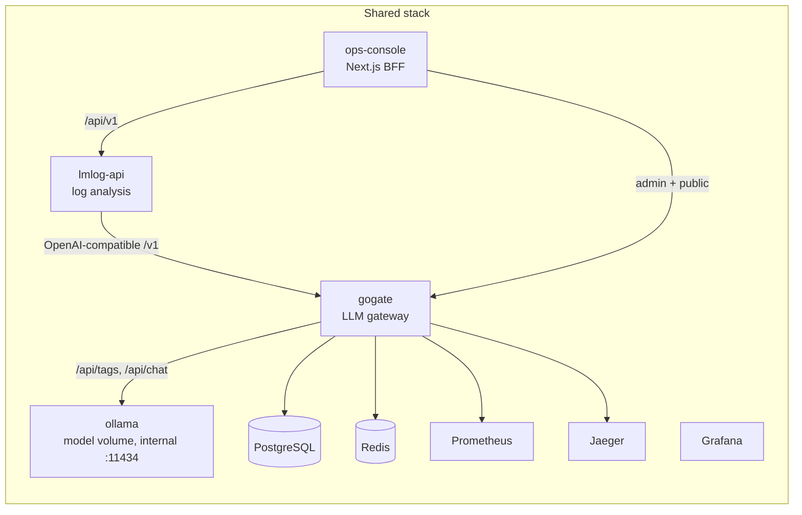

# aifirst shared AI stack

Общий compose-стек для `gogate`, `lmlog` и `ops-console`. Ollama здесь —
**общая внешняя инфраструктура**, а не часть одного из сервисов.



## Владение

| Компонент | Отвечает за | Не делает |
| --- | --- | --- |
| `ollama` | модели, volume, `ollama pull` | не публикуется наружу |
| `gogate` | провайдеры, таймауты, retry, fallback, rate limit, кэш, метрики, стоимость, audit | не анализирует логи |
| `lmlog-api` | ingest, сигнатуры, ошибки, тренды, эвристики | не ходит в Ollama в этом стеке |
| `ops-console` | UI/BFF, агрегация gogate + lmlog | не знает про Ollama |

## Быстрый старт

Требования: Docker Compose v2, `make`, `curl`, `jq`, `openssl`.

```bash
cd infra
make init-env   # .env + пустой .secrets/runtime.env
make up         # postgres/redis/ollama → ollama pull → gogate → ключи → lmlog/ops
```

Первый `make up` скачивает модель (`qwen2.5:3b`, около 2 ГБ) и может занять
несколько минут.

После запуска:

- UI: <http://localhost:3100> (токен `CONSOLE_AUTH_TOKEN` из `.env`)
- gogate API: <http://localhost:8080/v1>
- gogate admin: <http://localhost:9090/admin/v1>
- lmlog health: <http://localhost:8090/healthz>
- Prometheus: <http://localhost:9092>
- Grafana: <http://localhost:3000>
- Jaeger: <http://localhost:16686>

Полезные команды:

```bash
make smoke            # health + upload + explain; ожидает source=llm
make smoke-fallback   # останавливает gogate и проверяет source=heuristic
SMOKE_REQUIRE_LLM=0 make smoke   # разрешить heuristic
make pull-model       # только ollama pull
make keys             # создать/проверить ключи gateway
make config           # docker compose config -q
make down             # остановить, volumes сохранить
make reset            # удалить volumes и .secrets
```

## Ключи

`make up` создаёт через admin API gogate:

- tenant `lmlog` и ключ `lmlog`;
- tenant `ops-console` и ключ `ops-console-playground`;
- квоты RPM/TPM для `lmlog`;
- `.secrets/runtime.env` с `GOGATE_API_KEY` и `GOGATE_PLAYGROUND_API_KEY`.

Файл `.secrets/runtime.env` подключается как `env_file` к `lmlog-api` и
`ops-console`; в git он не попадает. Ключи можно пересоздать через `make keys`
(старый ключ при этом не отзывается автоматически — отзовите его через admin API,
если нужна ротация).

## Модель

- Тег задаётся одной переменной `OLLAMA_MODEL` (по умолчанию `qwen2.5:3b`).
- Из неё выводятся `GOGATE_OLLAMA_MODELS` и `LMLOG_MODEL`.
- Модель не бейкается в образ: `ollama-pull` — one-shot job, `make pull-model` —
  повторный pull.
- Ollama не публикует `11434` на хост: только `expose` внутри сети стека.
- `OLLAMA_NUM_PARALLEL=1`, `OLLAMA_MAX_LOADED_MODELS=1`.

## Standalone-режимы

Каждый репозиторий можно запустить отдельно:

| Режим | Ollama | `LMLOG_LLM_MODE` |
| --- | --- | --- |
| `infra/` (полный стек) | поднимает `infra` | `gateway` |
| `gogate` standalone | профиль `ai` в `gogate/docker-compose.yml` | — |
| `lmlog` standalone | профиль `ai` в `lmlog/docker-compose.yml` | `direct` |
| `ops-console` standalone | никто | — |

> **Важно:** standalone `ai`-профили и полный стек взаимоисключающие. Не
> запускайте два Ollama одновременно: это двойной расход RAM и конфликт
> `127.0.0.1:11434`. Для полного стека используйте `infra/`.

## Деградация

- `gogate` недоступен → `lmlog` возвращает `source=heuristic`, ingest/scan/trends
  работают.
- Ollama недоступна → `gogate` отвечает `503`/`all_providers_unavailable`,
  `lmlog` уходит в heuristic.
- `lmlog` недоступен → `ops-console` показывает degraded, остальные экраны
  работают.
- `lmlog-api` не ждёт `gogate: service_healthy` специально: он должен стартовать
  и работать без gateway.

## Переменные

Основные значения — в [.env.example](.env.example). Секреты генерирует
`scripts/init-env.sh`; gateway-ключи — `scripts/bootstrap-keys.sh`.

| Переменная | Назначение |
| --- | --- |
| `OLLAMA_MODEL` | pinned-тег модели |
| `GOGATE_OLLAMA_BASE_URL` | `http://ollama:11434` |
| `GOGATE_OLLAMA_MODELS` | модель, которую видит `/v1/models` |
| `GOGATE_ALLOW_PRIVATE_UPSTREAMS` | `true` для внутренней Ollama |
| `GOGATE_API_KEY` | ключ lmlog → gogate (runtime) |
| `GOGATE_PLAYGROUND_API_KEY` | ключ ops-console → gogate (runtime) |
| `LMLOG_LLM_MODE` | `gateway` в этом стеке |
| `LMLOG_MODEL` | должен совпадать с `OLLAMA_MODEL` |
| `LMLOG_API_TOKEN` | Bearer для lmlog и ops-console |
| `CONSOLE_AUTH_TOKEN` | вход в ops-console |

## Troubleshooting

| Симптом | Что проверить |
| --- | --- |
| `source=heuristic` | `LMLOG_LLM_MODE`, `GOGATE_BASE_URL`, `GOGATE_API_KEY`, `/v1/models` |
| `model_not_found` | `OLLAMA_MODEL` и `GOGATE_OLLAMA_MODELS` расходятся |
| `all_providers_unavailable` | Ollama не поднялась или модель не скачана |
| `401 invalid_api_key` | ключ не создан/отозван; выполните `make keys` |
| `lmlog` не видит ключ | есть ли `.secrets/runtime.env`, запущен ли `make up` |
| Два Ollama | остановите standalone `ai`-профиль или `infra` |
| `bind: address already in use` | измените `GOGATE_HTTP_PORT`, `GOGATE_ADMIN_PORT`, `LMLOG_SERVE_PORT`, `CONSOLE_PORT` и другие host-порты в `.env` |
| Пустой `/v1/models` | `GOGATE_BOOTSTRAP_PROVIDERS=true` и непустой `GOGATE_OLLAMA_MODELS` |

## Документация

- [ADR 0001: LLM ownership](docs/adr/0001-llm-ownership.md) ·
  [EN](docs/adr/0001-llm-ownership.en.md)
- [AI workflow](AI_WORKFLOW.md)
- `gogate/README.md`, `lmlog/README.md`, `ops-console/README.md`
