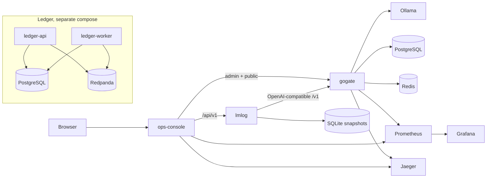
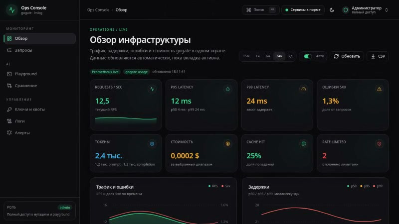
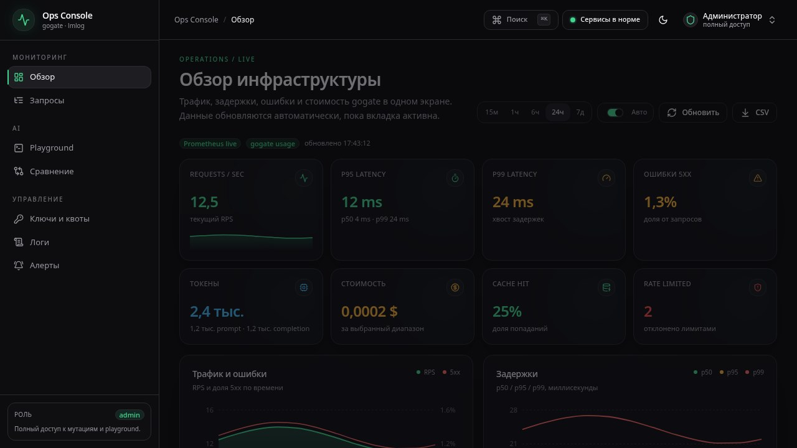
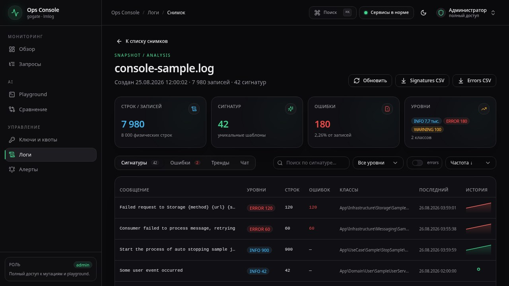

# AI Ops Stack

[](https://github.com/yugrinovD/ai-ops-stack/actions/workflows/ci.yml)
[](LICENSE)
[](https://github.com/yugrinovD/ai-ops-stack/releases)

Локальный стенд вокруг AI-шлюза: `gogate`, `lmlog`, `ops-console` и отдельный
`ledger`. Поднимается одним `make up`, внешние ключи не нужны — по умолчанию
mock и Ollama.

Началось с логов: надоело вручную разгребать миллионы строк и искать в них
ошибки. Из этого вырос `lmlog`, потом понадобился `gogate` — чтобы не тащить
внешние ключи в тесты, а дальше появилась консоль.

`ledger` — отдельная история. Он не часть AI-контура, просто ещё один проект,
который было удобно держать рядом.

## Что внутри

**gogate** — шлюз к LLM. Принимает OpenAI-совместимые запросы, умеет mock,
Ollama и любой OpenAI-compatible upstream. На mock держит 500 RPS и p99 меньше
миллисекунды. Это про прокси, не про скорость модели.

**lmlog** — разбор логов. Считает сигнатуры, ошибки и тренды, объясняет через
локальную LLM или эвристику. На стенде переваривал 12M строк в сутки.

**ops-console** — веб-консоль. Дашборд, playground, ключи и квоты, разбор логов
и трейсы. Браузер общается только с BFF, токены остаются на сервере.

**ledger** — double-entry ledger на Go. Идемпотентность, outbox,
reconciliation, Kafka/Redpanda. В бенчмарке держит 2000 запросов в секунду.

## Как это связано



`gogate` — единственный, кто ходит в Ollama. `lmlog` вызывает `gogate`,
`ops-console` — их обоих. `ledger` поднимается отдельно и с AI-контуром не
связан.

## Быстрый старт

Нужны Docker Compose v2, `make`, `curl`, `jq` и `openssl`. Go, Python и Node
понадобятся только если запускать проекты вне Docker.

Compose собирает образы из соседних каталогов, поэтому репозитории должны лежать
рядом:

```text
workspace/
  ai-ops-stack/
  gogate/
  lmlog/
  ops-console/
  ledger/
```

```bash
git clone git@github.com:yugrinovD/ai-ops-stack.git
cd ai-ops-stack

./scripts/clone-all.sh   # клонирует остальные четыре репозитория
make init-env            # .env + .secrets/runtime.env
make up                  # postgres/redis/ollama -> pull -> gogate -> ключи -> lmlog/ops
make smoke               # health + upload + explain (ожидает source=llm)
```

Первый запуск качает `qwen2.5:3b` (~2 ГБ) и может занять несколько минут. Два
Ollama одновременно лучше не запускать: это двойной расход RAM и конфликт порта
`11434`.

После запуска:

- UI: <http://localhost:3100> (`CONSOLE_AUTH_TOKEN` из `.env`)
- gogate API: <http://localhost:8080/v1>
- lmlog: <http://localhost:8090/healthz>
- Prometheus: <http://localhost:9092>, Grafana: <http://localhost:3000>, Jaeger: <http://localhost:16686>

Проверка деградации:

```bash
make smoke-fallback   # останавливает gogate и ожидает source=heuristic
```

`ledger` запускается из своего каталога:

```bash
cd ../ledger
make up
```

## Демо

[](docs/demo.mp4)

Короткий UI-highlight: dashboard, playground, compare, logs, traces и keys.
Полный сценарий на 3–5 минут лежит в [docs/DEMO.md](docs/DEMO.md).

| | |
| --- | --- |
|  |  |

## Что не докручено

- Ollama работает на CPU с моделью 3B. Для демо хватает, для продакшена — нет.
- Полное видео с голосом пока не записано, есть только 28-секундный highlight.
- В `ops-console` простой токен и две роли. Это не IdP.
- `lmlog` хранит состояние в SQLite и рассчитан на один процесс.
- `ledger` специально не production-PSP: без PCI DSS, KYC/AML и FX.

## Ссылки

- [Operations](docs/OPERATIONS.md) · [English](docs/OPERATIONS.en.md)
- [AI workflow](AI_WORKFLOW.md)
- [Changelog](CHANGELOG.md)
- [ADR 0001: LLM ownership](docs/adr/0001-llm-ownership.md)
- [gogate](https://github.com/yugrinovD/gogate) · [lmlog](https://github.com/yugrinovD/lmlog) · [ops-console](https://github.com/yugrinovD/ops-console) · [ledger](https://github.com/yugrinovD/ledger)

## Лицензия

MIT. См. [LICENSE](LICENSE).
