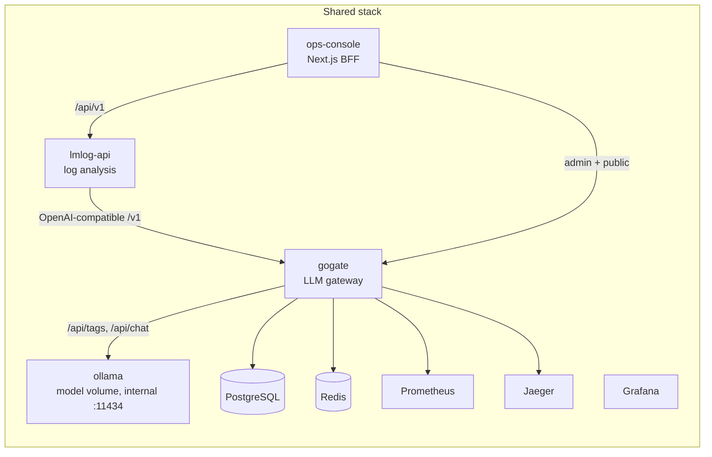

# AI Ops Stack

A shared Compose stack for `gogate`, `lmlog` and `ops-console`. Ollama is
**shared external infrastructure**, not a part of either service.



## Ownership

| Component | Owns | Does not do |
| --- | --- | --- |
| `ollama` | models, volume, `ollama pull` | not published to the host |
| `gogate` | providers, timeouts, retries, fallback, limits, cache, metrics, cost, audit | no log analysis |
| `lmlog-api` | ingest, signatures, errors, trends, heuristics | no direct Ollama access in this stack |
| `ops-console` | UI/BFF, aggregation of gogate + lmlog | no Ollama knowledge |

## Quick start

Requirements: Docker Compose v2, `make`, `curl`, `jq`, `openssl`.

```bash
cd ai-ops-stack
make init-env   # .env + empty .secrets/runtime.env
make up         # postgres/redis/ollama → ollama pull → gogate → keys → lmlog/ops
```

The first `make up` downloads the model (`qwen2.5:3b`, about 2 GB) and can take
a few minutes.

After startup:

- UI: <http://localhost:3100> (`CONSOLE_AUTH_TOKEN` from `.env`)
- gogate API: <http://localhost:8080/v1>
- gogate admin: <http://localhost:9090/admin/v1>
- lmlog health: <http://localhost:8090/healthz>
- Prometheus: <http://localhost:9092>
- Grafana: <http://localhost:3000>
- Jaeger: <http://localhost:16686>

Useful targets:

```bash
make smoke            # health + upload + explain; expects source=llm
make smoke-fallback   # stops gogate and expects source=heuristic
SMOKE_REQUIRE_LLM=0 make smoke   # allow heuristic
make pull-model       # ollama pull only
make keys             # create/verify gateway keys
make config           # docker compose config -q
make down             # stop, keep volumes
make reset            # remove volumes and .secrets
```

## Keys

`make up` uses the gogate admin API to create:

- tenant `lmlog` and key `lmlog`;
- tenant `ops-console` and key `ops-console-playground`;
- RPM/TPM quotas for `lmlog`;
- `.secrets/runtime.env` with `GOGATE_API_KEY` and
  `GOGATE_PLAYGROUND_API_KEY`.

`.secrets/runtime.env` is mounted as an `env_file` into `lmlog-api` and
`ops-console`; it is never committed. `make keys` recreates missing keys; old
keys are not revoked automatically — rotate them through the admin API.

## Model

- The tag is a single variable, `OLLAMA_MODEL` (default `qwen2.5:3b`).
- `GOGATE_OLLAMA_MODELS` and `LMLOG_MODEL` derive from it.
- The model is never baked into an image: `ollama-pull` is a one-shot job and
  `make pull-model` re-runs it.
- Ollama does not publish `11434` on the host; it is `expose`d inside the stack.
- `OLLAMA_NUM_PARALLEL=1`, `OLLAMA_MAX_LOADED_MODELS=1`.

## Standalone modes

| Mode | Ollama | `LMLOG_LLM_MODE` |
| --- | --- | --- |
| `ai-ops-stack/` (full stack) | started by `ai-ops-stack` | `gateway` |
| `gogate` standalone | `ai` profile in `gogate/docker-compose.yml` | — |
| `lmlog` standalone | `ai` profile in `lmlog/docker-compose.yml` | `direct` |
| `ops-console` standalone | nobody | — |

> **Important:** standalone `ai` profiles and the full stack are mutually
> exclusive. Do not run two Ollama containers at once: double RAM usage and a
> `127.0.0.1:11434` conflict. Use `ai-ops-stack/` for the full stack.

## Degradation

- `gogate` down → `lmlog` returns `source=heuristic`; ingest/scan/trends work.
- Ollama down → `gogate` returns `503`/`all_providers_unavailable`; `lmlog`
  falls back to heuristics.
- `lmlog` down → `ops-console` shows degraded, other screens keep working.
- `lmlog-api` intentionally does not wait for `gogate: service_healthy`: it must
  start and work without the gateway.

## Environment

See [.env.example](.env.example). `scripts/init-env.sh` generates secrets;
`scripts/bootstrap-keys.sh` creates gateway keys.

| Variable | Purpose |
| --- | --- |
| `OLLAMA_MODEL` | pinned model tag |
| `GOGATE_OLLAMA_BASE_URL` | `http://ollama:11434` |
| `GOGATE_OLLAMA_MODELS` | model advertised by `/v1/models` |
| `GOGATE_ALLOW_PRIVATE_UPSTREAMS` | `true` for internal Ollama |
| `GOGATE_API_KEY` | lmlog → gogate key (runtime) |
| `GOGATE_PLAYGROUND_API_KEY` | ops-console → gogate key (runtime) |
| `LMLOG_LLM_MODE` | `gateway` in this stack |
| `LMLOG_MODEL` | must match `OLLAMA_MODEL` |
| `LMLOG_API_TOKEN` | Bearer token for lmlog and ops-console |
| `CONSOLE_AUTH_TOKEN` | ops-console login |

## Troubleshooting

| Symptom | Check |
| --- | --- |
| `source=heuristic` | `LMLOG_LLM_MODE`, `GOGATE_BASE_URL`, `GOGATE_API_KEY`, `/v1/models` |
| `model_not_found` | `OLLAMA_MODEL` and `GOGATE_OLLAMA_MODELS` differ |
| `all_providers_unavailable` | Ollama is down or the model was not pulled |
| `401 invalid_api_key` | key missing/revoked; run `make keys` |
| lmlog cannot see the key | `.secrets/runtime.env` exists; did you run `make up`? |
| Two Ollama containers | stop the standalone `ai` profile or `ai-ops-stack` |
| `bind: address already in use` | change `GOGATE_HTTP_PORT`, `GOGATE_ADMIN_PORT`, `LMLOG_SERVE_PORT`, `CONSOLE_PORT` and other host ports in `.env` |
| Empty `/v1/models` | `GOGATE_BOOTSTRAP_PROVIDERS=true` and non-empty `GOGATE_OLLAMA_MODELS` |

## Documentation

- [ADR 0001: LLM ownership](docs/adr/0001-llm-ownership.en.md) ·
  [RU](docs/adr/0001-llm-ownership.md)
- [AI workflow](AI_WORKFLOW.md)
- `gogate/README.md`, `lmlog/README.md`, `ops-console/README.md`
